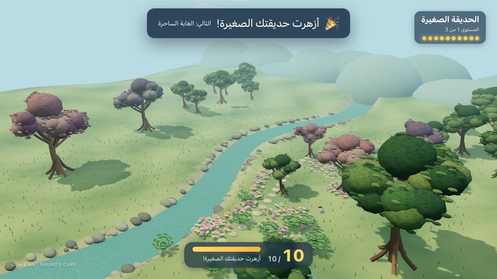
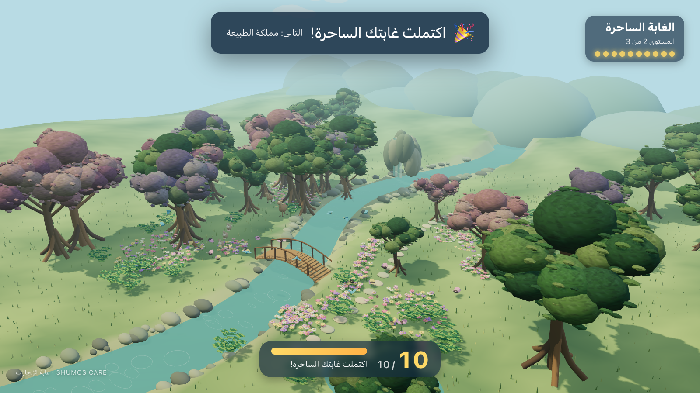
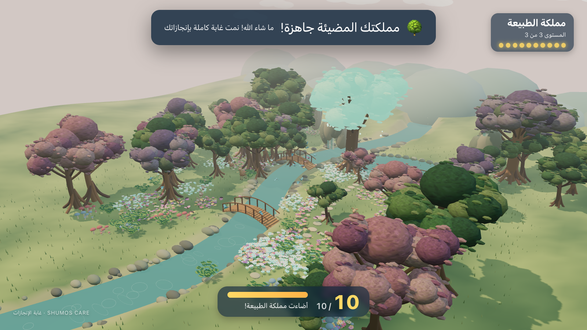

# Achievement Forest 3D — غابة الإنجازات

Local implementation in `feature/achievement-forest-3d`, worktree `/private/tmp/shumos-achievement-forest`, based on Achievement City's committed branch `1bcdbc4`. No push, deployment, or production rule publication was performed.

## Delivered scope

| Status | Evidence / scope |
|---|---|
| IMPLEMENTED | Native canonical game `achievement-forest-3d`, Arabic Control, shared Display registry, Firebase liveSession, controller ownership, save-once patient history, existing visit linking, existing INTERACTIVE_REWARDS category. |
| IMPLEMENTED | Exactly three levels, 30 scenery milestones, configurable target of 3–30 confirmations per level. Previous areas remain in the same world; direct selection creates scenery only. |
| IMPLEMENTED | Normal / assisted confirmation, undo of the open level, pause/resume, safety pause, restart confirmation, safe ending, results, notes before finalization, reload recovery. |
| IMPLEMENTED | One shared reward-session/Gamepad runtime used by both City and Forest. Button mapping, edge detection, held-button suppression, disconnect status and manual fallback. |
| BROWSER TESTED | Real Three.js rendering and gameplay screenshots for all three levels and growth milestones. Separate Chrome profiles emulate touch Control and projector-sized Display. Shared VisitProvider attachment verified in a separate Control browser check. See JSON evidence below. |
| SIMULATED | Gamepad events through a mocked browser Gamepad API. Synthetic staff, patient, and visit data in isolated Firebase emulators. |
| PHYSICAL HARDWARE UNVERIFIED | Real handheld controller/Joy-Con, projector, iPad, audio audibility and patient comfort. Browser viewport emulation is not physical hardware testing. |
| NOT IMPLEMENTED | Cinematic reference-image fidelity, skeletal animal animation, reflective/refraction water, a vegetation LOD system, or externally authored premium 3D assets. The supplied references inform the palette and woodland composition; this is a stylized procedural interpretation with lower visual fidelity. |

## Three continuous levels

1. **الحديقة الصغيرة — The Little Garden.** Seedling, sapling, flower beds, blossom tree, butterflies, flower pathway, mushrooms, pond, vegetation and garden celebration.
2. **الغابة الساحرة — The Enchanted Forest.** Keeps the completed garden and adds tall woodland, waterfall, wooden bridge, rabbits, deer, birds, clearings, ferns, grove and more butterflies.
3. **مملكة الطبيعة — The Kingdom of Nature.** Keeps both previous areas and adds lake, ancient trees, central tree, luminous flowers, additional falls and bridges, animals, fireflies, gardens and tree illumination with gentle camera pullback and victory chimes.

Milestones are scenery, not additional stages or a curriculum. Exactly three level cards appear in setup. `worldTargets` maps every accepted confirmation to a distinct increase, including partial growth for targets above ten. All growing groups animate in parallel without delaying the next confirmation. Reload initializes directly from authoritative progress; it does not replay achievements. Undo reduces scenery toward the revised state. Direct level-three selection records only actual level-three confirmations.

## Actual gameplay screenshots

These are browser captures of the real renderer, not the attached reference images or generated promotional artwork.

| Area | Start / baseline | Intermediate | Completed |
|---|---|---|---|
| Garden | [Start](screenshots/01-garden-start.png), [First growth](screenshots/02-first-growth.png) | [Five confirmations](screenshots/03-garden-mid.png) | [Completed garden](screenshots/04-garden-complete.png) |
| Forest | [Completed garden baseline](screenshots/05-forest-baseline.png) | [Forest growth](screenshots/06-forest-mid.png) | [Completed forest](screenshots/07-forest-complete.png) |
| Kingdom | [Completed forest baseline](screenshots/08-kingdom-baseline.png) | [Kingdom growth](screenshots/09-kingdom-mid.png) | [Completed kingdom](screenshots/10-kingdom-complete.png) |





The three setup cards and library thumbnail are optimized WebP derivatives of these captures. Provenance is appended to the shared thumbnail manifest.

## Artwork, animation and audio

All forest assets are original procedural geometry and a locally synthesized foliage texture. No third-party asset license or external asset download is required. Trees have curved roots, trunks and branches, layered crowns, individual leaf detail and a varied vertex palette. Flower beds, grasses, rocks and bridges are merged into batches. The original rabbit/deer/bird/butterfly models use gentle transforms and wing movement; they have no skeletal rig.

The world includes undulating vertex-colored terrain, hills, clouds, a river ribbon, moving ripples, waterfalls and a lake basin. Crown sway, wing movement, animal idle motion, water effects and optional fireflies keep the forest alive. Reduced motion freezes ambient movement and camera drift; reduced effects lowers particles; low quality disables shadows and limits pixel ratio. Resize and teardown dispose GPU geometry, materials, textures, audio and listeners.

Audio uses existing Shumos synthesis primitives and its shared browser speech provider. Introduction: «كل ما تنجز تمرينك، بتكبر غابتك وتصير أجمل!». Growth chimes, subdued synthesized water/birds, sparse music, halfway encouragement and completion speech respect sound/voice/music/mute settings. Browser audio unlocking remains required. No paid TTS service or production API was used by these tests.

## Authority, controller and history

Forest reuses City's pure therapist-confirmation reducer. A confirmation means only that the therapist observed and confirmed a real exercise. Animation, Gamepad and visual baseline never detect physical movement or produce clinical scores.

The accidental-bounce window is 300 ms; separate presses at or beyond that threshold count independently. Holds do not repeat. The shared Gamepad mapping is retained across reward games; a button can be learned in Control. Manual confirmation remains available without a controller or sensors. Network loss freezes authoritative progression and requires explicit resume.

Permanent results use the existing `saveSessionHistoryOnce` and HistorySaver, with a per-run immutable key. They include exercise, starting/ending level, targets, confirmed/assisted/skipped counts, undo count, duration/active time, completion and therapist notes. Existing shared stage/difficulty fields are compatibility mirrors of the three levels, not hidden stages. Finalized history cannot be undone; notes are collected before ending or edited through the existing history-note workflow.

The existing VisitProvider detects saved Forest results and attaches them to the active parent visit through `visitResultClaims`. The dedicated browser check covers confirmation, reload recovery, one partial history record, and automatic parent attachment. No separate patient/session/visit database was introduced.

## Validation

- Full unit suite: **2,361 passed**, **171 skipped** across **196 passing / 21 skipped files** (`npx vitest run --maxWorkers=2`). Skipped suites require their own emulator switches; they are not counted as verified.
- TypeScript: `npx tsc --noEmit` passes.
- Repository ESLint: no errors; six existing warnings in unrelated QA scripts. Forest source passes focused lint.
- Production build: passes with City and Forest opt-in flags, using `next build --webpack`. Webpack is used because this isolated worktree shares node_modules through a symlink outside its Turbopack root. Google font fetching required network access; no source font workaround was introduced.
- Firebase emulator: Forest's focused rules tests cover ownership, malformed payload rejection, three levels, immutable history, invalid counts, preserving existing game writes and parent visit claims. **11/11 Forest rules tests and 11/11 City rules regression tests pass** against the merged candidate. Results recorded in the evidence/checks files.
- Browser: [Control/Display results](evidence/e2e-results.json), [parent visit results](evidence/visit-results.json), [library follow-up](evidence/library-results.json), [render samples](validation/render-results.json). Gamepad testing is simulated.

Two long active-visit browser runs timed out during Chrome/CDP evaluation under concurrent rendering/check load. The lighter actual-Control visit check passed all four assertions. The final long synchronization run passed 60/61 checks; its fixed-delay category-filter assertion ran before the asynchronous route update. The separate readiness-based library check passed 3/3, including that filter. The standalone parent-visit check passed 4/4. Raw outcomes are retained rather than treating the timed-out assertion as a pass. This is not evidence of real controller or projector operation.

## Performance and limits

Recorded rendering samples use local Chrome/Metal, 1600×900, device pixel ratio 1, balanced quality. They are short observations, not a sustained hardware benchmark. The captured run overlapped local validation load: garden start 46 FPS, completed garden 35.4 FPS, completed forest 28.1 FPS, completed kingdom 21.6 FPS. Earlier two-device completed-kingdom sampling recorded 36 FPS; the final run under local load recorded 19.7 FPS. Draw submissions ranged from approximately 134 to 836; shadow rendering is included in the triangle counter.

The fully populated kingdom is the heaviest scene. Low quality and reduced effects are provided, but intended clinic/projector hardware still needs measurement. Geometry is constructed up front; invisible milestone geometry is uploaded as it becomes visible. There is no distance-based LOD or skeletal animation system. Friendly animal motion and water effects are stylized. Visual polish falls below the detail in the provided references; no console-equivalent claim is made.

## Merge and release requirements

The original main checkout and all concurrent uncommitted history/YouTube/security work remain untouched. This branch depends on Achievement City for the existing reward category, confirmation engine, configuration and Gamepad adapter. Merge City's branch first, then this feature, or merge the feature branch with awareness that it includes City ancestry. The only City runtime change extracts its existing logic into a shared parameterized hook; City and Forest then supply their own live/history adapters.

Shared files changed include registries, capabilities, Display resolver, live/history parsers/types, non-clinical analytics exclusions, three-level history views, visit safety engine recognition, audio exclusion cases, thumbnail provenance and regression counts.

`database.rules.json` and the console-copy JSON are **local merged candidates**, based on the City baseline. They must be reconciled with the newer uncommitted security rules before any release. Do not replace those newer files wholesale. `rules-patch.py` preserves existing expressions when extending a compatible baseline and refuses a duplicate Forest addition. No production rules were published.

Production opt-in is `NEXT_PUBLIC_ACHIEVEMENT_FOREST_3D=true`; City and the other optional games retain their own flags. The 21-game count is validated with the development registry. Approval and a merged rule review are still needed before a production release, as requested.

## Reproduce locally

From this worktree, reuse installed dependencies or install from the existing lockfile. Start the isolated emulators and app in separate terminals:

```sh
bash docs/achievementforest3d/validation/emulators.sh
bash docs/achievementforest3d/validation/dev-emu.sh dev
```

Then run:

```sh
npx vitest run --maxWorkers=2
AF_RULES_EMULATOR=1 npx vitest run lib/achievementforest/__tests__/rules.emulator.test.ts
node docs/achievementforest3d/validation/visit.mjs
node docs/achievementforest3d/validation/library.mjs
AF_PROFILE=/private/tmp/af-review node docs/achievementforest3d/validation/e2e.mjs docs/achievementforest3d/evidence http://127.0.0.1:3754
node docs/achievementforest3d/validation/shots.mjs
node docs/achievementforest3d/validation/assets.mjs
```

The browser helpers use the installed macOS Chrome executable. The seeder resets only the isolated `demo-af-rules` emulator namespace. Review harness `/dev/achievement-forest-preview` is development-only and does not write patient history.
